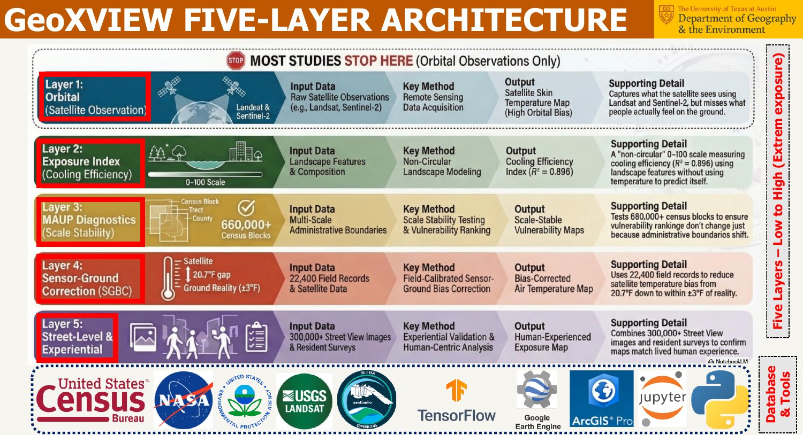
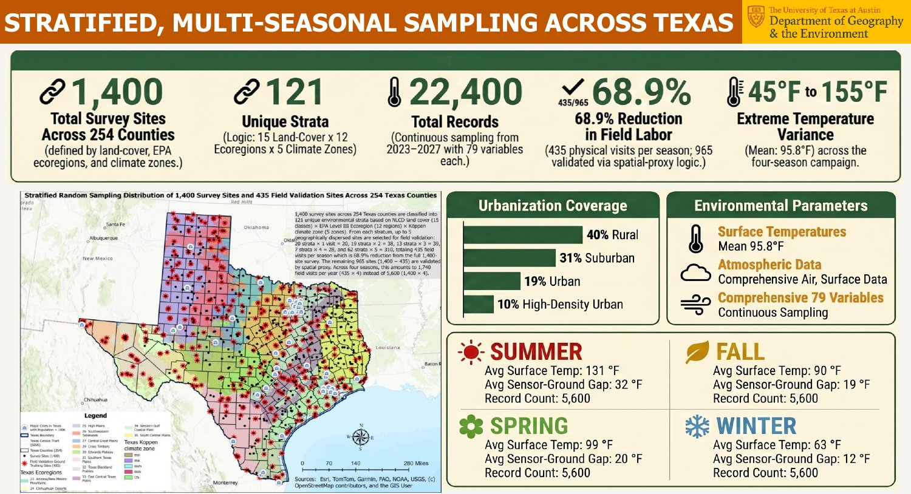
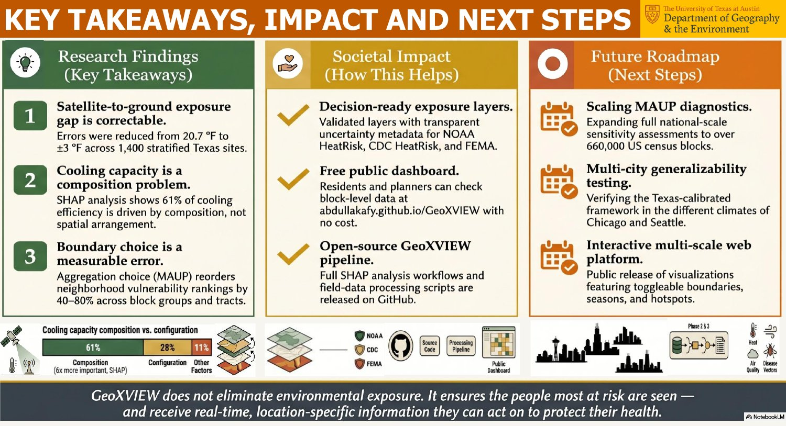

# GeoXVIEW

**Geospatially eXplicit Vertically Integrated Exposure Workflow**

[](https://github.com/AbdullaKafy/GeoXVIEW/actions/workflows/ci.yml)
[](https://colab.research.google.com/github/AbdullaKafy/GeoXVIEW/blob/main/notebooks/01_quickstart.ipynb)
[](https://doi.org/10.26153/tsw/64936)
[](LICENSE)
[](data/README.md)

**Live dashboard:** https://abdullakafy.github.io/GeoXVIEW/

Environmental exposure maps decide where cooling centers, tree planting and air-quality programs go. But the same place can look low-risk on a county map and high-risk on a tract map. GeoXVIEW measures exposure on the ground across Texas, combines it into one index, and reports how much that index depends on the map unit used to show it.


## The problem

Two errors sit inside most environmental exposure maps:

1. **Sensor-ground bias.** Satellites measure the skin temperature of roofs and roads, not the heat people feel. In the field the gap was 9 to 45 °F.
2. **The map unit (MAUP).** The same place can be "low" on a county map and "high" on a block group map. Boundary choice alone moved exposure rankings by 40 to 80%.

Agencies such as NOAA, CDC, EPA and FEMA publish exposure layers with neither correction nor an uncertainty note. GeoXVIEW measures both errors and corrects them.

## Five-layer architecture



| Layer | Input | Method | Output |
|---|---|---|---|
| 1. Orbital | Landsat and Sentinel-2 | Remote sensing | Satellite skin temperature (where most studies stop) |
| 2. Exposure index | Land cover composition and configuration | Non-circular landscape model (temperature is not an input) | Cooling Efficiency Index, 0 to 100 (R² 0.896) |
| 3. MAUP diagnostics | County, tract, block group and other boundaries | Scale stability testing and vulnerability ranking | Scale-stable vulnerability maps |
| 4. Sensor-ground correction | 22,400 field records plus satellite data | Field-calibrated bias correction | Bias-corrected air temperature map (20.7 °F gap reduced to about ±3 °F) |
| 5. Street level and experience | 300,000+ street view images and resident surveys | Experiential validation | Human-experienced exposure map |

## Field program



| | |
|---|---|
| Sites | 1,400 across all 254 Texas counties |
| Strata | 121 occupied strata from 15 land cover classes x 12 EPA Level III ecoregions x 5 Köppen climate zones |
| Records | 22,400 (79 variables each), continuous sampling 2023 to 2027 |
| Field effort | 435 physical visits per season; the other 965 sites are validated through a spatial proxy (a 68.9% cut in field labor) |
| Coverage | 40% rural, 31% suburban, 19% urban, 10% high-density urban |
| Temperature range | 45 to 155 °F (mean surface temperature 95.8 °F) |
| Instruments | HIKMICRO B1L thermal camera (±2 °F, 240 x 320, emissivity 0.95), Kestrel 5000 environmental meter (air temperature, humidity, wind, WBGT), Atmotube PRO air quality monitor (PM1, PM2.5, PM10, VOCs) |

| Season | Mean surface temperature | Mean sensor-ground gap | Records |
|---|---|---|---|
| Summer | 131 °F | 32 °F | 5,600 |
| Spring | 99 °F | 20 °F | 5,600 |
| Fall | 90 °F | 19 °F | 5,600 |
| Winter | 63 °F | 12 °F | 5,600 |

Survey hours ran from about 10:00 AM to 7:00 PM, with peak readings from 3:00 to 5:00 PM. In summer, surfaces passed 120 °F, shade cooled them by 30 to 40 °F, and the sensor-ground gap peaked at 60.2 °F.

## Findings



1. **The satellite-to-ground gap can be corrected.** Error fell from 20.7 °F to about ±3 °F across the 1,400 stratified sites.
2. **Cooling depends on composition.** SHAP analysis shows that 61% of cooling efficiency comes from what the land cover is (composition), 28% from how it is arranged (configuration) and 11% from other factors.
3. **Boundary choice is a measurable error.** Changing the map unit reorders neighborhood vulnerability rankings by 40 to 80% across block groups and tracts.

Austin model (census tracts): XGBoost with spatial cross-validation, R² 0.896, RMSE 2.65 °F; Moran's I of the Cooling Efficiency Index 0.475.

These results come from the dissertation work presented at the UT Austin Libraries Scholars Lab Fellows Research Showcase (May 1, 2026). The tract-level model and raw field logs are not in this repository.

**Next steps:** national MAUP sensitivity testing on 660,000+ US census blocks; testing the Texas-calibrated framework in Chicago and Seattle; a multi-scale web platform with switchable boundaries, seasons and hotspots.

## What you can run from this repo

| | |
|---|---|
| Map units compared | County, county subdivision, ZIP code, census tract, block group (28,642 polygons) |
| Scale effect in the released data | 114 of 1,393 sites (8.2%) change exposure class with the map unit; county maps disagree with finer units for 6 to 7% of sites |
| Validation lesson | For the same model, random cross-validation gives R² 0.85; spatial block cross-validation gives R² 0.53 |

## What is in this repo

```
data/          Site table, seasonal readings, unit-level EEI for 5 scales (see data/README.md)
src/geoxview/  Python package: EEI, MAUP diagnostics, spatial block cross-validation
notebooks/     01_quickstart.ipynb runs every analysis below in about one minute
figures/       Figures made by the notebook; figures/showcase holds three slides from the May 2026 showcase
index.html, GeoXVIEW_Dashboard.html, GeoXVIEW_StoryMap.html   Live site (GitHub Pages)
tests/         Tests check that the package reproduces the published dashboard values
```

## Quickstart

```bash
git clone https://github.com/AbdullaKafy/GeoXVIEW.git
cd GeoXVIEW
pip install -e ".[geo]"
```

```python
import geoxview as gx

sites = gx.load_sites()                     # 1,400 field sites
eei = gx.compute_eei(sites)                 # rebuild the index from its 3 components
spread = gx.scale_spread(gx.load_site_scales())
print(spread.class_changes.sum(), "sites change class with the map unit")
```

## Method in brief

**1. One index, three visible parts.** The Environmental Exposure Index (EEI) is the equal-weight mean of normalized air quality, land surface temperature and land cover scores (0 to 100). Each part stays in the data, so a high score in one part is never hidden by a low score in another. `gx.weight_sensitivity()` tests the weights: across 500 random weight sets near equal weights, site rankings keep a median Spearman correlation of 0.96, while a median 11.7% of sites change class.

**2. Same site, five map units.** Each site is placed in its county, subdivision, ZIP code, tract and block group, and each unit reports its own mean EEI. `gx.scale_spread()` and `gx.class_agreement()` show where the answer depends on the boundary.


**3. Honest validation.** Nearby sites are similar, so random folds leak information. `gx.spatial_block_cv()` holds out whole 100 km blocks.


The cross-validation example predicts site mean air temperature from land cover and street-view features. It demonstrates the validation method on the released data; it is not the dissertation's tract-level model.

## Data and privacy

The released data are site-level summaries already shown in the public dashboard. Raw instrument logs, photos and resident survey responses are not included. Survey data are covered by a UT Austin IRB protocol and are reported only in aggregate in publications. Site names and locations are the same as in the public dashboard.

## Cite

Use the "Cite this repository" button (from `CITATION.cff`), or:

Al Kafy, A. (2026). *GeoXVIEW: Geospatially eXplicit Vertically Integrated Exposure Workflow for Scale Adaptive Environmental Exposure Modeling*. Texas ScholarWorks. https://doi.org/10.26153/tsw/64936

Related talk: Al Kafy, A. GeoXVIEW: A Spatially Explicit Scale Adaptive Framework for Field Validated and Bias Corrected Environmental Exposure Modeling. AGU Fall Meeting 2026, oral presentation, session SY51B-03.

## Author

Abdulla Al Kafy, Department of Geography and the Environment, The University of Texas at Austin. Advisor: Kelley A. Crews.
[Website](https://abdullaalkafy.com) | [Google Scholar](https://scholar.google.com/citations?user=vkBgMkIAAAAJ) | [ORCID](https://orcid.org/0000-0002-7544-5165)

Support: Harry E. and Bernice M. Moore Fellowship (Hogg Foundation for Mental Health), the UT Austin Libraries Scholars Lab Fellowship, and a Geological Society of America Graduate Student Research Grant.
