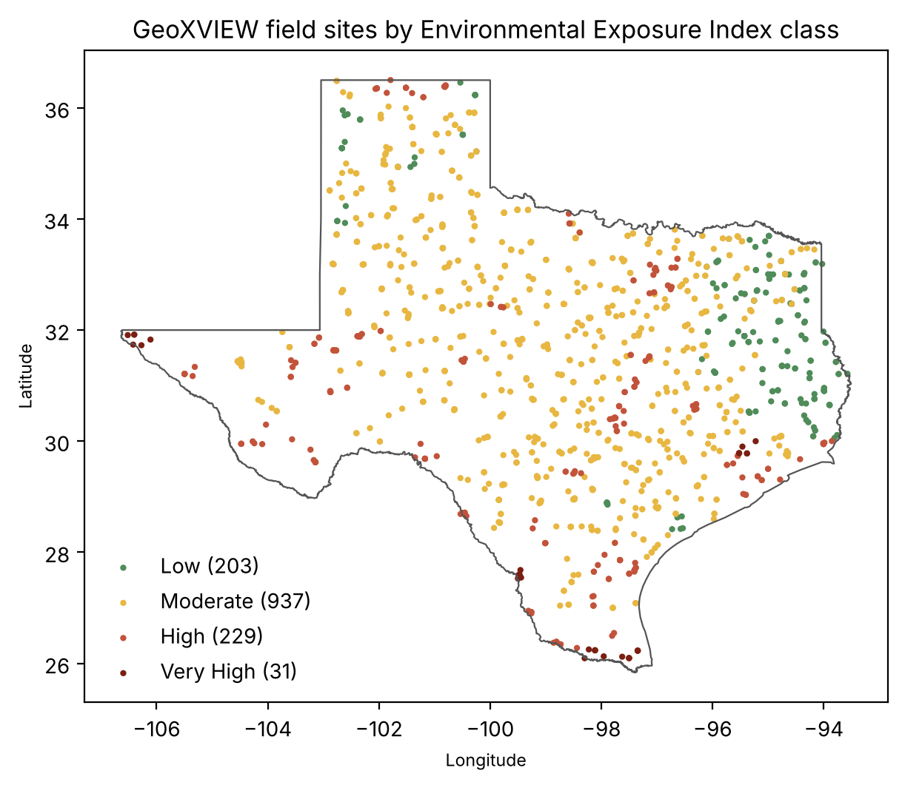
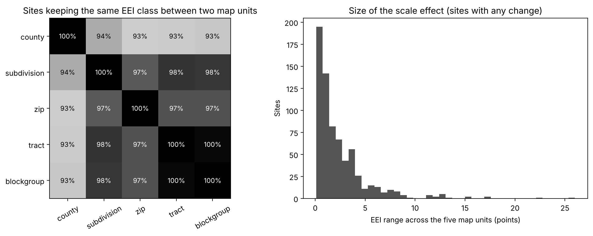
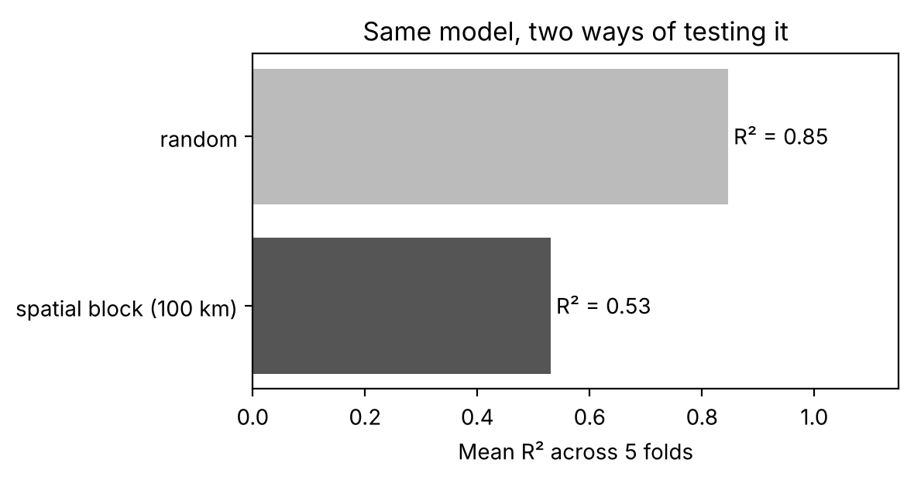

# GeoXVIEW

**Geospatially eXplicit Vertically Integrated Exposure Workflow**

[](https://github.com/AbdullaKafy/GeoXVIEW/actions/workflows/ci.yml)
[](https://colab.research.google.com/github/AbdullaKafy/GeoXVIEW/blob/main/notebooks/01_quickstart.ipynb)
[](https://doi.org/10.26153/tsw/64936)
[](LICENSE)
[](data/README.md)

**Live dashboard:** https://abdullakafy.github.io/GeoXVIEW/

Environmental exposure maps decide where cooling centers, tree planting and air-quality programs go. But the same place can look low-risk on a county map and high-risk on a tract map. GeoXVIEW measures exposure on the ground across Texas, combines it into one index, and reports how much that index depends on the map unit used to show it.



## Key numbers

| | |
|---|---|
| Field sites | 1,400 across all 254 Texas counties, 15 land cover classes, 12 EPA Level III ecoregions, 5 Köppen climate zones |
| Field program | 13 seasonal campaigns (2023 to 2026), 250,000+ calibrated readings, timed to MODIS Aqua overpass |
| Map units compared | County, county subdivision, ZIP code, census tract, block group (28,642 polygons) |
| Scale effect | 114 of 1,393 sites (8.2%) change exposure class depending on the map unit; county maps disagree with finer units for 6 to 7% of sites |
| Validation lesson | For the same model, random cross-validation gives R² 0.85, spatial block cross-validation gives R² 0.53 |

Dissertation result (model and data not in this repo): tract-level land surface temperature, XGBoost under spatial blocking, R² 0.896, RMSE 2.65°F.

## What is in this repo

```
data/          Site table, seasonal readings, unit-level EEI for 5 scales (see data/README.md)
src/geoxview/  Python package: EEI, MAUP diagnostics, spatial block cross-validation
notebooks/     01_quickstart.ipynb runs every analysis below in about one minute
figures/       Figures made by the notebook
index.html, GeoXVIEW_Dashboard.html, GeoXVIEW_StoryMap.html   Live site (GitHub Pages)
tests/         Tests check that the package reproduces the published dashboard values
```

## Quickstart

```bash
git clone https://github.com/AbdullaKafy/GeoXVIEW.git
cd GeoXVIEW
pip install -e ".[geo]"
```

```python
import geoxview as gx

sites = gx.load_sites()                     # 1,400 field sites
eei = gx.compute_eei(sites)                 # rebuild the index from its 3 components
spread = gx.scale_spread(gx.load_site_scales())
print(spread.class_changes.sum(), "sites change class with the map unit")
```

## Method in brief

**1. One index, three visible parts.** The Environmental Exposure Index (EEI) is the equal-weight mean of normalized air quality, land surface temperature and land cover scores (0 to 100). Each part stays in the data, so a high score in one part is never hidden by a low score in another. `gx.weight_sensitivity()` tests the weights: across 500 random weight sets near equal weights, site rankings keep a median Spearman correlation of 0.96, while a median 11.7% of sites change class.

**2. Same site, five map units.** Each site is placed in its county, subdivision, ZIP code, tract and block group, and each unit reports its own mean EEI. `gx.scale_spread()` and `gx.class_agreement()` show where the answer depends on the boundary.



**3. Honest validation.** Nearby sites are similar, so random folds leak information. `gx.spatial_block_cv()` holds out whole 100 km blocks.



The cross-validation example predicts site mean air temperature from land cover and street-view features. It demonstrates the validation method on the released data; it is not the dissertation's tract-level model.

## Data and privacy

The released data are site-level summaries already shown in the public dashboard. Raw instrument logs, photos and resident survey responses are not included. Survey data are covered by a UT Austin IRB protocol and are reported only in aggregate in publications. Site names and locations are the same as in the public dashboard.

## Cite

Use the "Cite this repository" button (from `CITATION.cff`), or:

Al Kafy, A. (2026). *GeoXVIEW: Geospatially eXplicit Vertically Integrated Exposure Workflow for Scale Adaptive Environmental Exposure Modeling*. Texas ScholarWorks. https://doi.org/10.26153/tsw/64936

Related talk: Al Kafy, A. GeoXVIEW: A Spatially Explicit Scale Adaptive Framework for Field Validated and Bias Corrected Environmental Exposure Modeling. AGU Fall Meeting 2026, oral presentation, session SY51B-03.

## Author

Abdulla Al Kafy, Department of Geography and the Environment, The University of Texas at Austin. Advisor: Kelley A. Crews.
[Website](https://abdullaalkafy.com) | [Google Scholar](https://scholar.google.com/citations?user=vkBgMkIAAAAJ) | [ORCID](https://orcid.org/0000-0002-7544-5165)

Support: Harry E. and Bernice M. Moore Fellowship (Hogg Foundation for Mental Health), the UT Austin Libraries Scholars Lab Fellowship, and a Geological Society of America Graduate Student Research Grant.
